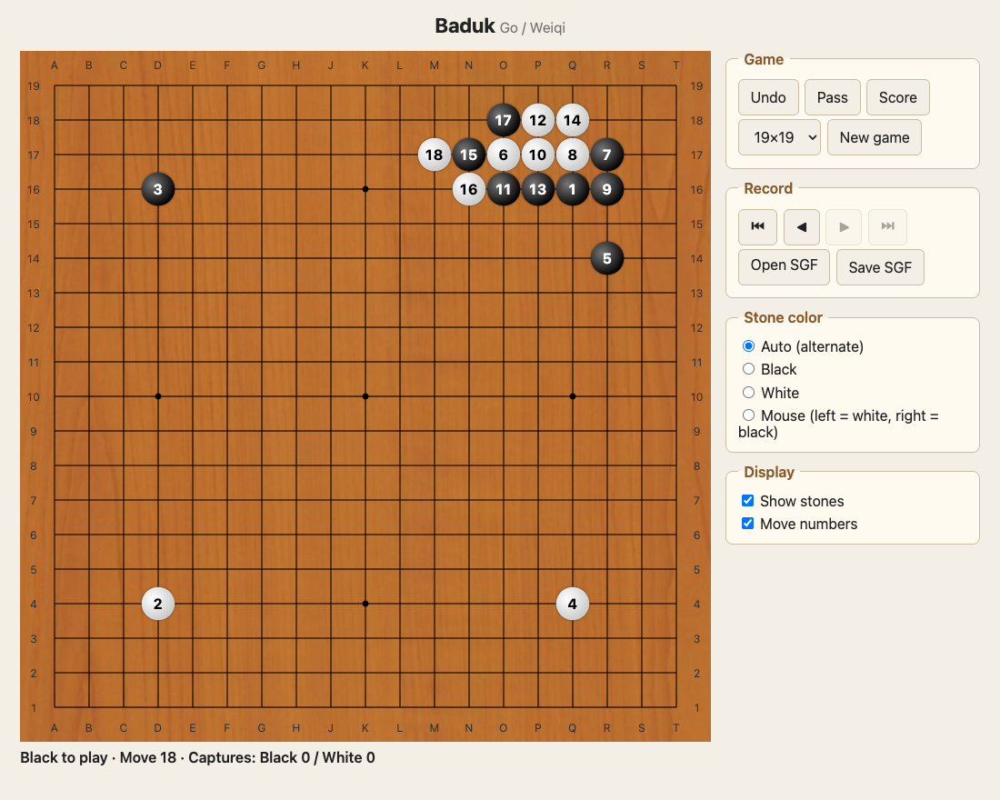
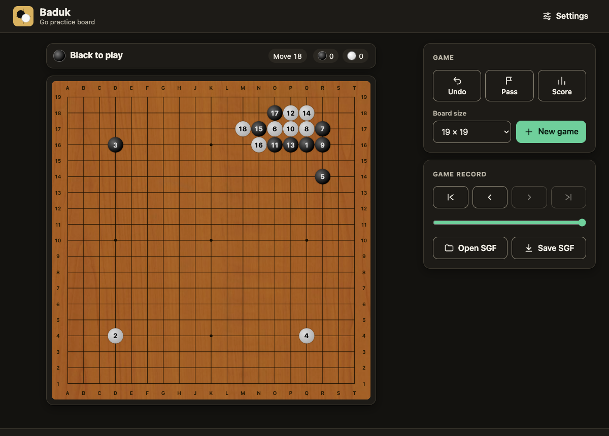
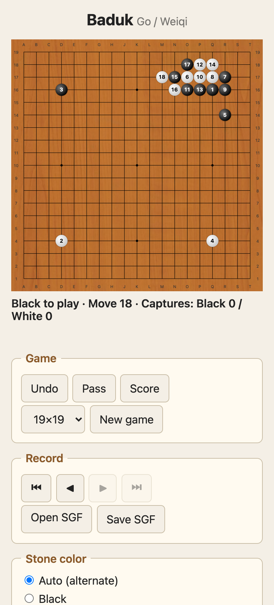
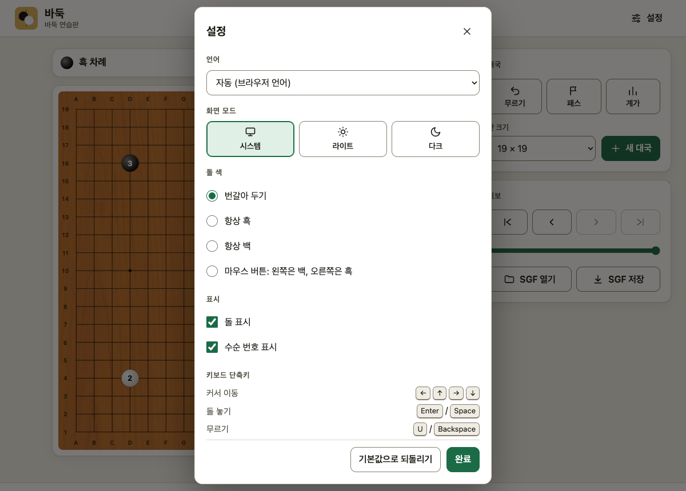

# baduk



**Baduk (Go)** is a web app for practicing the game of Go and working with game records. I first built it in 2012 with plain HTML5 and JavaScript so my father could enjoy the game online, and rewrote it from scratch in TypeScript for v2.0. v2.1 added multiple languages, themes and a new accessible design, and v2.2 adds richer game records: a move list, variations, comments and editable game information.

**https://hbjorn.dev/baduk/**

## Features

**Play and practice**
- Alternating play, captures, suicide prevention and simple ko
- Stone color modes: auto / black / white / mouse (left click = white, right click = black), handy for solo practice and setting up problems
- Move numbers, last-move marker, show/hide stones
- Undo, pass, area scoring with komi
- 9×9, 13×13 and 19×19 boards

**Game records**
- Open and save SGF files, including variations, comments and game information
- Move list: every move with its coordinates; click or use the arrow keys to jump to a move
- Variations: play a different move during replay to start a new line, and switch between lines at any branch
- Comments on every move (and the starting position), stored in the SGF `C` property
- Game info editor: players, ranks, date, event, place, result and komi
- Step through a game with the first / previous / next / last buttons or a slider
- The game is saved in the browser and survives a reload

**Multilingual**
- English, Korean (한국어), Japanese (日本語), Simplified Chinese (简体中文) and Traditional Chinese (繁體中文)
- The language is picked automatically from the browser's language settings and can be changed in **Settings**

**Appearance and accessibility**
- Light, dark or system theme, chosen in **Settings**
- Responsive layout for desktop and mobile; touch friendly
- Fully playable with the keyboard (arrow keys move a cursor, Enter places a stone) with screen reader announcements
- Visible focus indicators, WCAG AA contrast, respects reduced-motion preferences

### Limitations

- Scoring does not detect dead stones. Remove them by hand before scoring.
- Only the first game of an SGF file is read, and setup stones or markup inside the game tree are ignored. A variation is cut off at its first illegal move.
- Superko is not supported.
- No online play, chat or AI yet.

## Screenshots

| Light | Dark |
| --- | --- |
|  |  |

| Mobile | Settings (Korean) |
| --- | --- |
|  |  |

## Development

Requires Node.js 20 or later.

```sh
npm install
npm run dev      # development server
npm test         # unit tests
npm run lint     # ESLint
npm run build    # type-check and build static files into dist/
npm run preview  # preview the production build
```

### Layout

```
src/core/   Pure TypeScript with no DOM access. All game rules live here and are tested.
  board.ts    immutable board, group and liberty computation
  rules.ts    move validation (captures, suicide, ko)
  game.ts     move sequence, undo, record navigation
  score.ts    area scoring
  sgf.ts      SGF parser and serializer
  record.ts   SGF <-> Game conversion
src/i18n/   Translation catalogs (en, ko, ja, zh-CN, zh-TW) and locale detection
src/ui/     SVG board rendering and keyboard input, theme, DOM translation, localStorage
src/main.ts wires the UI to the core
```

There are no runtime dependencies. Only the UI layer would need to change to move to a framework such as React.

### Translations

Every user-visible string lives in `src/i18n/`. `en.ts` is the source of truth; add a key there and to every other locale file (the compiler rejects missing keys and a test checks that placeholders match). To add a language, create a catalog, register it in `src/i18n/index.ts` (`LOCALES`, `LOCALE_NAMES`, `matchLocale`) and add it to the tests.

### Deployment

Pushing to `main` runs tests, builds the site and deploys it to GitHub Pages through GitHub Actions. The build uses relative paths, so it works on any static host. After each successful deploy, a second workflow deletes older deployment records and keeps only the live one.

## Versioning

Releases use two-part versions by default, for example `v1.2` or `v2.0`. A three-part version such as `v1.2.1` is used only for a hotfix. `package.json` uses the semver form (`1.2.0`, `1.2.1`) because npm requires it. See [CHANGES](CHANGES) and the [GitHub releases](https://github.com/hbjorn37/baduk/releases) for the history.

## License

[GPL-3.0-or-later](LICENSE). See [AUTHORS](AUTHORS) for credits.
