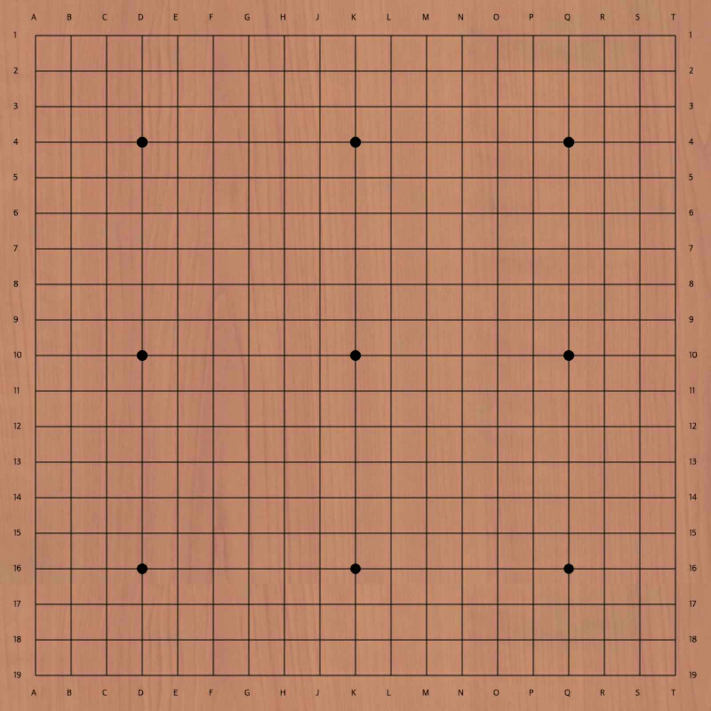
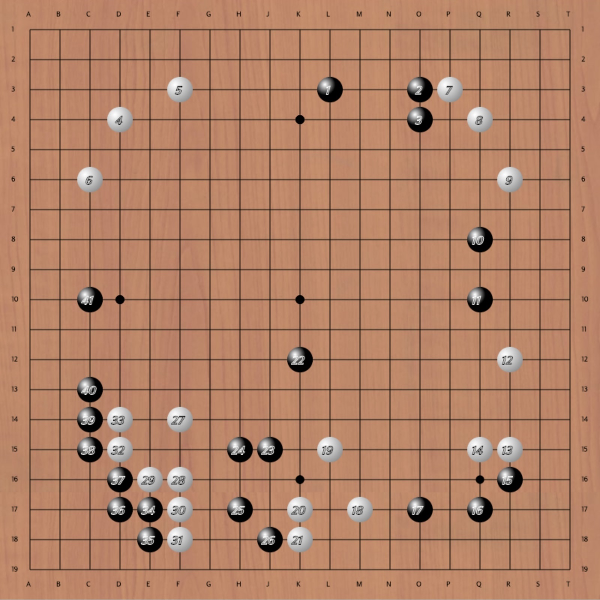
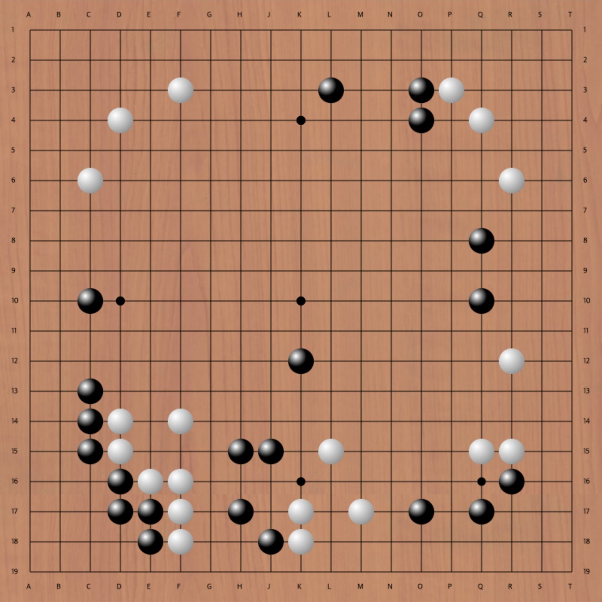

# baduk-web

**Baduk(Go)** is a popular board game that has long been loved in East Asia. Alpha-Go and Lee Se-dol's games attracted attention from all over the world. My father likes this game, but there weren't many ways to enjoy Baduk online than I decided to develop. So, this app has been implemented to play Baduk with the most accessible web, using HTML5 and JavaScript only.

## Features

These are the major features.

1. Access anywhere from PC or mobile web browser
1. Place both black and white by myself and display the order
1. Create user's own notation (Gibo) and save it
1. Make a game room and play online in real time
1. Chat between users who do not go through the server

Currently, No. 1 and 2 have been implemented and the rest are left in TODO. There are still parts that need to be touched, but there is no difference in practicing notation alone.

## Screenshots

## Authors

See the [AUTHORS](AUTHORS) file.

## Third-party code

Baduk contains code from these projects:

- jQuery JavaScript Library v1.8.0 - <http://jquery.com/> - Copyright (c) 2009 John Resig
